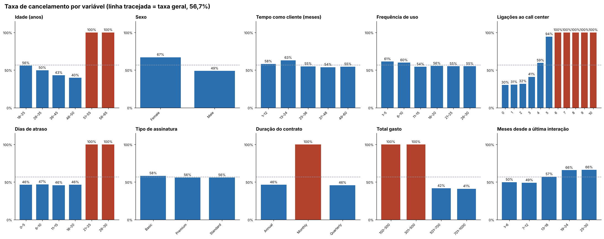
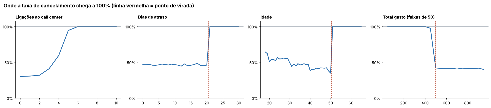
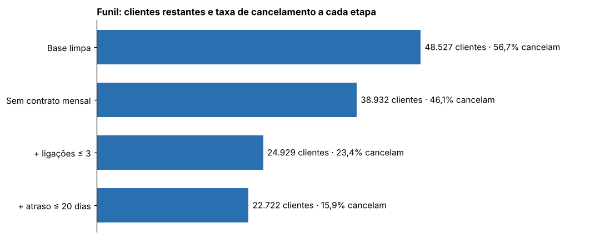
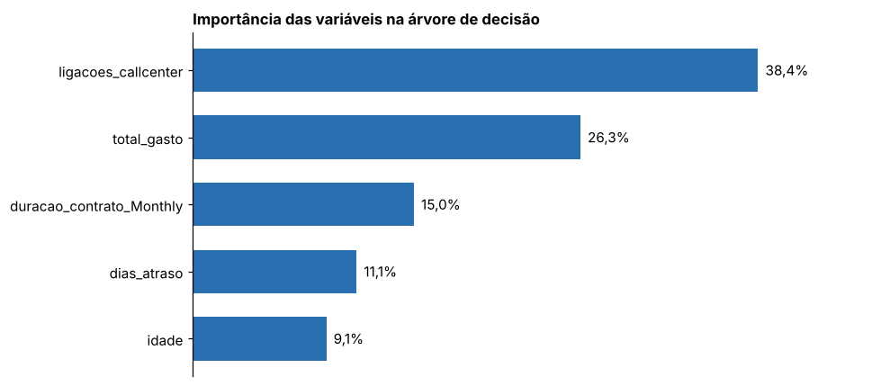
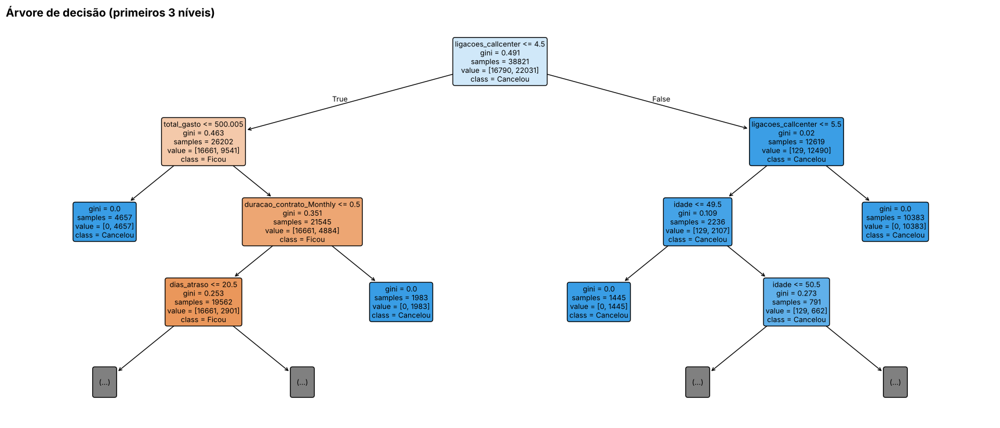

# 📉 Análise de Cancelamento de Clientes (Python)

Análise de dados que investiga **por que os clientes de uma empresa de assinaturas cancelam** e **quais ações teriam mais efeito para reduzir os cancelamentos**. Usa `pandas` para tratar e analisar a base, `matplotlib` para os gráficos e `scikit-learn` (árvore de decisão) para confirmar os resultados.

Projeto baseado na **Aula 2 da Jornada Python (Hashtag Treinamentos)**, com correções de método e uma etapa extra de machine learning.

> ⚠️ **A base de dados é fictícia** (fornecida pelo curso). Vários grupos cancelam exatamente 100%, o que não acontece em dados reais. Os resultados servem para praticar o método, não para concluir nada sobre uma empresa de verdade.

## O problema

A empresa tem a maioria da base formada por clientes que já cancelaram (**56,7%** da base limpa). A pergunta: quais fatores explicam os cancelamentos e quais ações reduzem esse número?

## Principais resultados

| Fator | Grupo de risco | Taxa de cancelamento no grupo | Ação sugerida |
|---|---|---|---|
| Duração do contrato | Mensal | 100% | Desconto em planos trimestrais e anuais |
| Ligações ao call center | 6 ou mais (5 ligações: 94,5%) | 100% | Resolver o problema do cliente em até 3 ligações |
| Dias de atraso | Mais de 20 | 100% | Política de resolver atrasos em até 10 dias |
| Idade | Mais de 50 anos | 100% | Investigar o motivo |
| Total gasto | Até 500 | 100% | Investigar o motivo |

Se as três ações da aula (contrato mensal, ligações e atraso) funcionassem 100%, a taxa geral cairia de **56,7% para cerca de 15,9%**. Com 50% de eficácia, para **36,3%**.







### Árvore de decisão (scikit-learn)

A árvore encontrou sozinha os mesmos cortes dos gráficos (ligações em 4,5 e 5,5; atraso em 20,5; contrato mensal; total gasto em 500; idade em 50). Variáveis mais importantes: ligações (38%), total gasto (26%), contrato mensal (15%), atraso (11%) e idade (9%).

O acerto de **97,8% no teste é irreal** e vem de a base ser fictícia e ter regras muito limpas. Aqui a árvore serve para **confirmar os cortes**, não para prever cancelamentos reais.





## Melhorias em relação ao código da aula

| Antes (código da aula) | Agora |
|---|---|
| `CustomerID` apagado logo de início | Duplicados conferidos **antes** de apagar o ID: 1.469 linhas repetidas (cópias exatas) foram removidas |
| Filtros apagavam linhas da própria tabela e mostravam só a taxa de quem sobrou | **Funil** que mostra cada etapa, e **cenários** com o impacto real na taxa geral |
| Ação "resolver em até 3 ligações", mas filtro com `<= 4` | Corte corrigido para **≤ 3**, coerente com a ação |
| Cortes escolhidos "no olho" nos gráficos | Cortes conferidos nos dados e confirmados pela árvore de decisão |
| Histogramas de contagem com `plotly` (uma janela por coluna) | Painel com a **taxa de cancelamento por grupo** em `matplotlib`, que aparece no GitHub |
| Idade e total gasto ignorados | Incluídos na análise (também chegam a 100%) |
| Sem aviso sobre causa e custo | Seção sobre correlação ≠ causa, teste A/B, custo e uso de sexo |
| Sem documentação | README, `requirements.txt` e comentários no notebook |

## Estrutura do projeto

```
analise-cancelamento-clientes/
├── analise_cancelamento_clientes.ipynb   # Notebook com toda a análise
├── cancelamentos.csv                     # Base de dados (50.000 clientes, fictícia)
├── requirements.txt                      # Bibliotecas necessárias
├── imagens/                              # Gráficos usados neste README
└── README.md
```

## Como rodar (Windows + VS Code)

Precisa do [Python 3](https://www.python.org/downloads/) e do [VS Code](https://code.visualstudio.com/) com a extensão **Python** (que inclui o suporte a notebooks).

1. Abra a pasta do projeto no VS Code (**Arquivo > Abrir Pasta**).
2. Abra o terminal (**Terminal > Novo Terminal**) e instale as bibliotecas:

   ```bash
   pip install -r requirements.txt
   ```

3. Abra o arquivo `analise_cancelamento_clientes.ipynb`, escolha o interpretador Python no canto superior direito e clique em **Executar Tudo** (*Run All*).

Os gráficos também são salvos de novo na pasta `imagens/`. Como alternativa ao VS Code, rode `jupyter notebook` no terminal e abra o arquivo no navegador.

## Sobre a base de dados

`cancelamentos.csv` tem 50.000 linhas e 12 colunas:

| Coluna | Descrição |
|---|---|
| `CustomerID` | Identificador do cliente (removido na análise) |
| `idade` | Idade do cliente |
| `sexo` | Sexo do cliente |
| `tempo_como_cliente` | Meses como cliente |
| `frequencia_uso` | Frequência de uso do serviço |
| `ligacoes_callcenter` | Ligações ao call center |
| `dias_atraso` | Dias de atraso no pagamento |
| `assinatura` | Tipo de assinatura (Basic, Standard, Premium) |
| `duracao_contrato` | Mensal, trimestral ou anual |
| `total_gasto` | Total gasto pelo cliente |
| `meses_ultima_interacao` | Meses desde a última interação |
| `cancelou` | 1 se cancelou, 0 se continua cliente |

Limpeza: 1.469 linhas duplicadas e 4 linhas com valores vazios removidas, restando **48.527 clientes**.

## Limitações

- **Base fictícia**: padrões e acerto da árvore são irreais.
- **Correlação não é causa**: "quem liga mais cancela mais" não prova que o atendimento causa o cancelamento. O caminho certo é um teste A/B antes de investir.
- **Sem custos**: falta comparar o custo de cada ação com a receita dos clientes mantidos.
- **Sexo**: a base mostra que mulheres cancelam mais, mas o sexo não é usado para segmentar ações nem entra na árvore.
- **Cenários simplificados**: tratam os grupos como independentes, mas na prática eles se sobrepõem.

## Tecnologias

- Python 3
- [pandas](https://pandas.pydata.org/): leitura, limpeza e análise
- [matplotlib](https://matplotlib.org/): gráficos
- [scikit-learn](https://scikit-learn.org/): árvore de decisão
- Jupyter Notebook
